# Eink Dash

A home-screen launcher for Android e-readers (Fidibook, Boox, PocketBook, Meebook, Bigme) and phones.
It turns the reader into a calm desk display: a dashboard of widgets drawn in pure black on white, with no animations and a full e-ink refresh on every change, so nothing ghosts.

Runs on **Android 4.2+** (minSdk 17), in **Persian and English** with full right-to-left layout and the Vazirmatn font.

<p>
  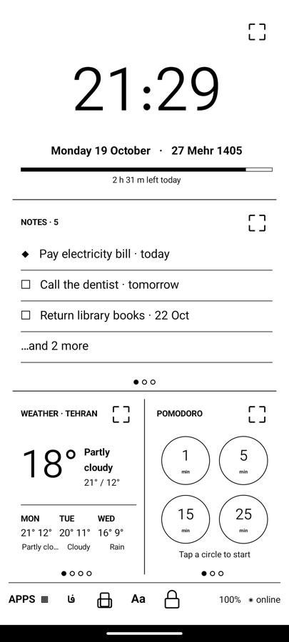
  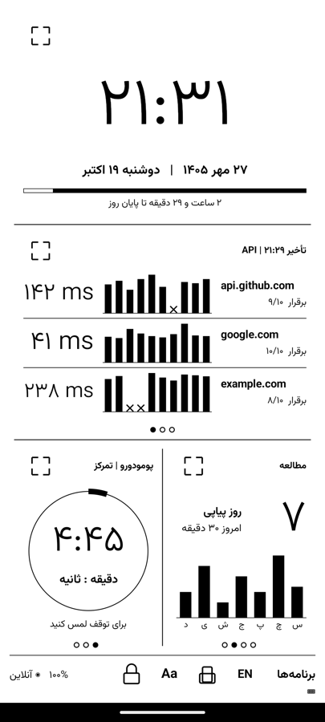
  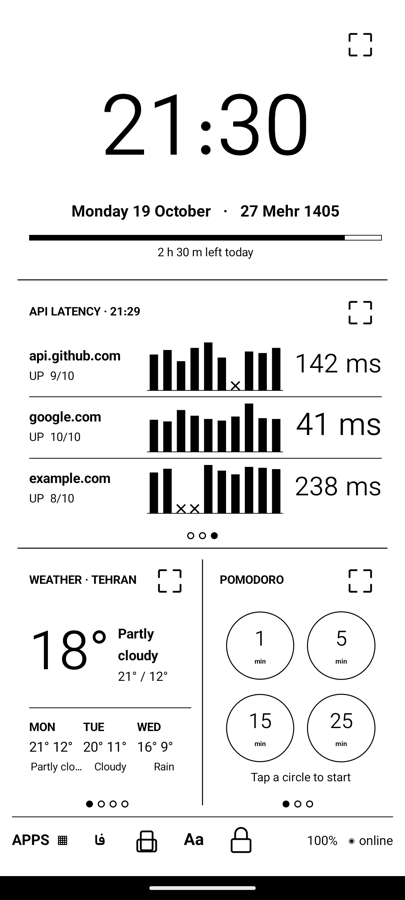
</p>

> Screenshots come from the Android emulator with sample data (weather, latency history, reading minutes).

## The dashboard

One page, five spots. Each spot below the clock is a **stack**: swipe it sideways to switch widgets, and the dots under it show where you are. **⛶** opens any widget full screen.

| Spot | Stack |
|---|---|
| Top | Clock: time, both calendars, how much of the day is left |
| Middle | **Notes/todo** ↔ Calendar ↔ API latency |
| Bottom left | Weather ↔ Quote of the day ↔ Reading stats ↔ Continue reading |
| Bottom right | Pomodoro ↔ Quick settings ↔ Battery |

The footer holds **Apps**, the language switch (**فا / EN**), rotate, **Aa** (large print), the lock, and battery/online status.

## Widgets

<p>
  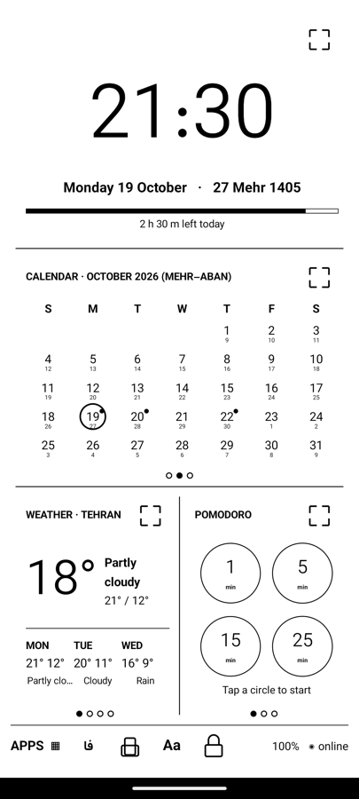
  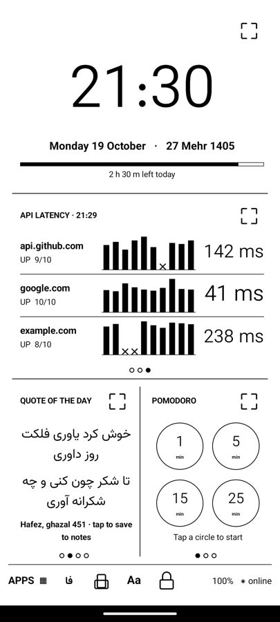
  
  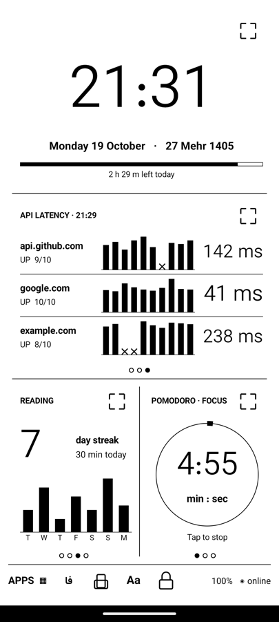
</p>

- **Clock**: big time, Gregorian and Jalali dates, a day-progress bar.
- **Notes / todo**: a ruled notebook page. Todos can have a due date; today's and overdue items (◆) come first.
- **Calendar**: this month as a grid. In Persian it's a Jalali month starting Saturday, with Gregorian numbers small underneath (and the other way round in English). Today is circled; days with due todos have a dot.
- **API latency**: one row per endpoint with uptime, a bar chart of the last 10 checks (✕ = failed) and the latest time in ms. Checked every 5 minutes, and skipped while offline.
- **Weather**: Open-Meteo (no API key), using device location or a city search; current conditions plus 3 days, cached for offline.
- **Quote of the day**: an opening couplet from Hafez's ghazals (495 bundled, works offline). Tap to save it to your notes.
- **Pomodoro**: when idle, four rings (1, 5, 15, 25 min); tap one to start. While running it shows mm:ss in a progress ring. When it ends, a full-screen notice appears, which works even on readers with no speaker. *Reading focus* can open your reader app and turn on Do Not Disturb.
- **Reading stats**: day streak and a 7-day bar chart, fed by finished reading-focus sessions.
- **Continue reading**: opens your reader (Fidibo by default).
- **Quick settings**: frontlight − / +, Wi-Fi, rotate, screen mode, Android settings.
- **Battery**: charge level and Wi-Fi.

## Screens

<p>
  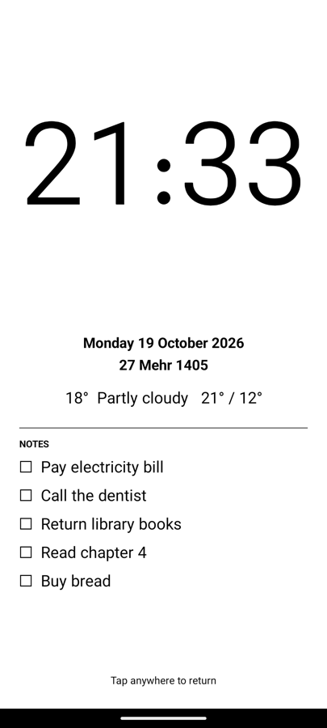
  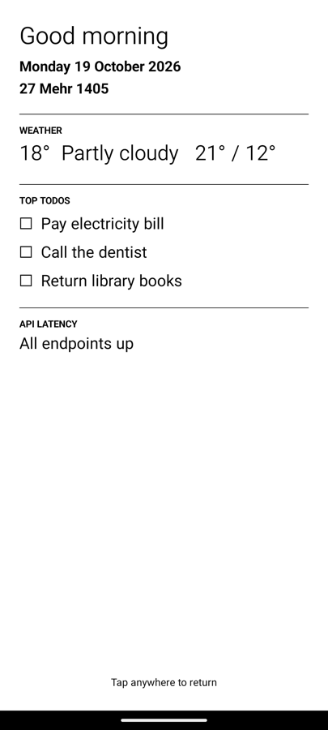
  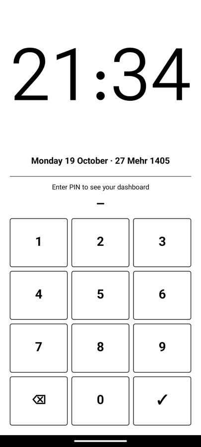
  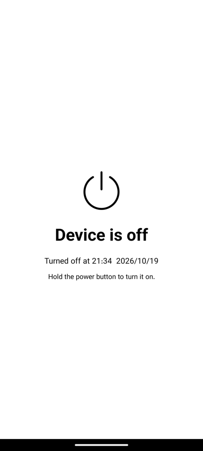
</p>

- **Sleep face**: after an idle spell the frontlight goes off and a calm page with the clock, weather and notes stays on the e-ink panel.
- **Morning summary**: once a day at a time you choose: both dates, the weather, your top todos, and any endpoints that are down.
- **Privacy lock**: the app's own PIN lock. It locks when idle, when the screen turns off and after a restart. While locked only the clock and date show; notes, endpoints, settings and apps stay hidden. The PIN is stored as a salted hash.
- **Device is off**: when the reader shuts down, the screen switches to a clear "Device is off" page. E-ink keeps that image without power, so a switched-off reader never looks like it's still on.
- **Night theme**: inside a night window, text is larger and the frontlight very dim; while charging at night a single giant clock shows.

<p>
  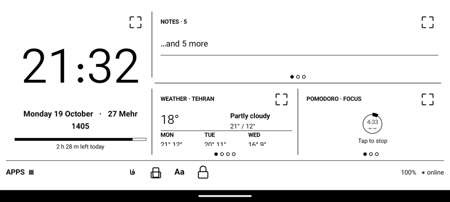
</p>
<p>
  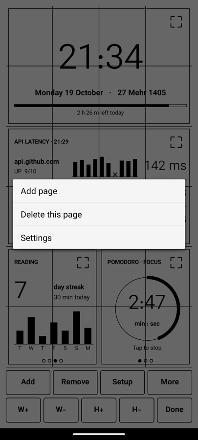
  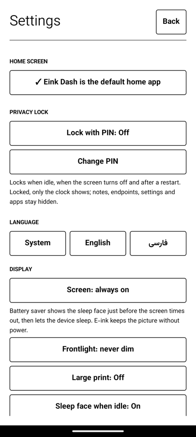
  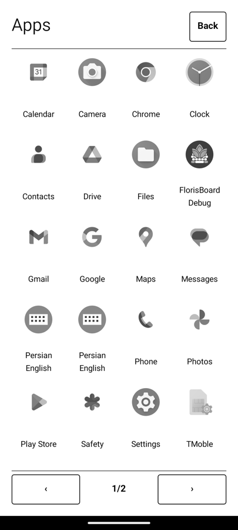
</p>

## More

- **Stays awake**: the launcher keeps the device from auto-locking and shows above Android's swipe lock, so waking it returns straight to the dashboard. *Battery saver* is available as an option: the sleep face goes up just before the screen timeout and the device then sleeps, with e-ink holding the picture.
- **Notes from your phone or PC**: turn on *Note page on Wi-Fi* in Settings, then open the address it shows (e.g. `http://192.168.1.20:8080`) in any browser on the same Wi-Fi. Add todos (with dates), download a backup or restore one. Everything needs the PIN shown in Settings.
- **Edit mode**: long-press the dashboard. Tap a spot, then Add (stacks onto that spot), Remove (the widget showing), Setup, W±/H± to resize, More for pages and Settings. Tap an empty cell to move a spot.
- **Large print (Aa)**: bigger text and its own simpler four-spot layout; your normal layout stays untouched.
- **Rotate**: portrait and landscape keep separate layouts, and the choice is remembered.
- **Default home**: Settings → *Set as default home app* (system prompt on Android 10+, the launcher chooser on 4.x).
- **Backup**: export or import layouts, settings and notes as JSON, from Settings or over Wi-Fi.
- **Page-turn and volume keys** flip drawer pages.

## Install

Download the APK from [Releases](https://github.com/arashrasoulzadeh/eink-dashboard/releases) or the latest **Debug build** run under Actions, or build it:

```bash
./gradlew assembleDebug
adb install -r app/build/outputs/apk/debug/app-debug.apk
```

Then press Home and choose Eink Dash, or use Settings → *Set as default home app*.

## Development

- Kotlin with plain framework Views and **no AndroidX**, so nothing raises the Android 4.2 floor. Networking is `HttpURLConnection` with TLS 1.2 forced on for Android 4.x.
- Run `./gradlew lintDebug`: it catches API-21+ calls that would crash on Android 4.2.
- CI: **Tests** (unit tests + lint) and **Debug build** (APK artifact) run on every push and pull request. Pushing a tag like `v0.2.0` attaches the APK to a GitHub release. The APK is debug-signed, which is fine for sideloading; add a signing config before distributing more widely.

Font: [Vazirmatn](https://github.com/rastikerdar/vazirmatn), SIL Open Font License 1.1 (`app/src/main/assets/fonts/OFL.txt`). Hafez text: public domain, from [Ganjoor](https://ganjoor.net).
